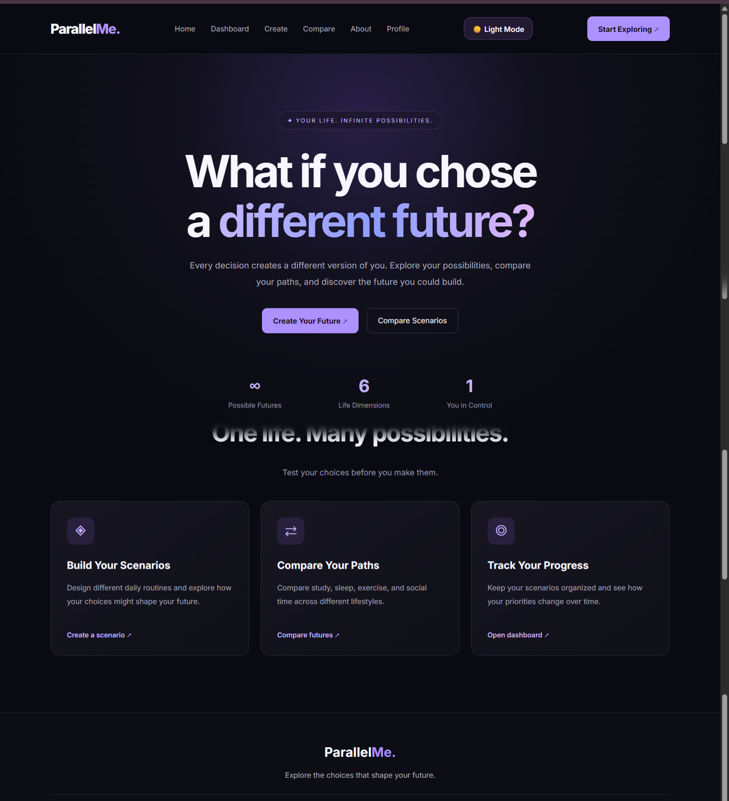
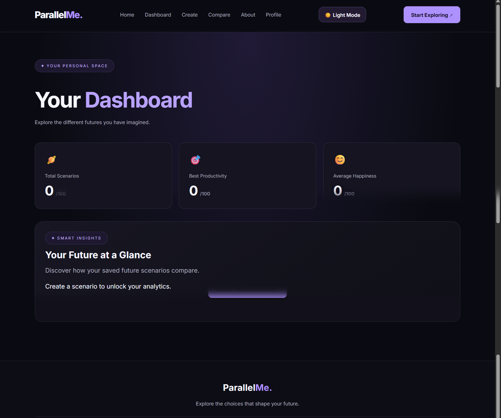
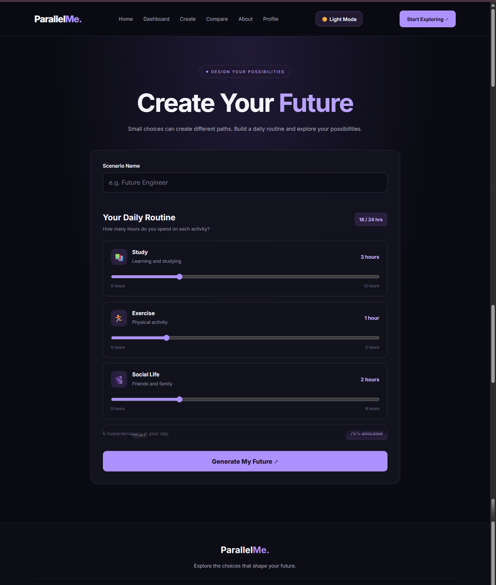
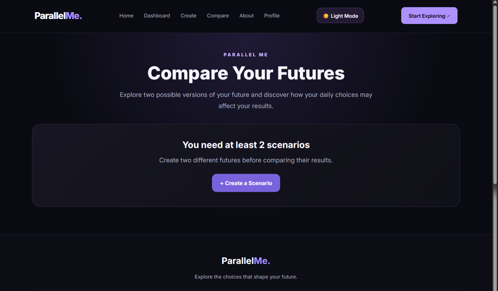

# 🌌 Parallel Me

<p align="center">
  <strong>Explore the Life You Could Have Lived.</strong>
  <br />
  Imagine different paths. Compare possibilities. Discover new perspectives.
  <br /><br />
  <a href="https://nayrasharaky.github.io/Parallel-Me/">
    <strong>🚀 Live Demo</strong>
  </a>
  &nbsp; | &nbsp;
  <a href="https://github.com/nayrasharaky/Parallel-Me">
    <strong>📂 Source Code</strong>
  </a>
</p>

<p align="center">
  
  
  
  
  
</p>

---

## 📖 About the Project

**Parallel Me** is an interactive web application built around one fascinating question:

*What if you had made a different choice?*

The application allows users to create alternative life scenarios, explore possible outcomes, and compare different paths. By examining indicators such as happiness and productivity, users can reflect on their goals and discover new perspectives.

Parallel Me combines a clean user experience with practical frontend development concepts in a modern React application.

## 📸 Screenshots

### 🏠 Home Page

Explore the main interface and discover the idea behind Parallel Me.



### 📊 Dashboard

Manage saved scenarios and explore their results.



### ✍️ Create Scenario

Create a new scenario and explore an alternative possibility.



### ⚖️ Compare Scenarios

Compare different scenarios and review their outcomes.



---

## ✨ Features

- 🏠 **Home Page** — Introduction to the Parallel Me experience.
- 📊 **Dashboard** — View and manage saved scenarios.
- ✍️ **Create Scenarios** — Explore alternative life possibilities.
- ⚖️ **Scenario Comparison** — Compare scenarios and their outcomes.
- 📈 **Results & Insights** — Review happiness and productivity indicators.
- 🔍 **Search & Filter** — Find scenarios quickly.
- ↕️ **Sorting** — Organize scenarios based on available sorting options.
- 💾 **Local Storage** — Save scenarios in the browser.
- 📤 **Backup & Restore** — Export scenarios and import backup files.
- 🔔 **Toast Notifications** — Receive feedback when performing actions.
- 📱 **Responsive Interface** — Designed for a user-friendly experience across screen sizes.

## 🛠️ Tech Stack

- **React** — Building interactive user interfaces.
- **JavaScript (ES6+)** — Application logic and functionality.
- **React Router DOM** — Client-side navigation.
- **Vite** — Development server and production build tool.
- **HTML5** — Web page structure.
- **CSS3** — Styling and layouts.
- **Local Storage API** — Local data persistence.
- **Lucide React** — Icons.

## 🚀 Live Demo

Experience the application online:

### [👉 Open Parallel Me](https://nayrasharaky.github.io/Parallel-Me/)

## 💻 Getting Started

### Prerequisites

Make sure you have [Node.js](https://nodejs.org/) and npm installed.

### Installation

**1. Clone the repository**

```bash
git clone https://github.com/nayrasharaky/Parallel-Me.git
```

**2. Navigate to the project folder**

```bash
cd Parallel-Me
```

**3. Install dependencies**

```bash
npm install
```

**4. Start the development server**

```bash
npm run dev
```

**5. Open the local URL**

Visit the URL displayed in your terminal, usually:

```text
http://localhost:5173
```

### Build for Production

Create an optimized production build:

```bash
npm run build
```

Preview the production build locally:

```bash
npm run preview
```

## 💾 Data Storage & Backup

Parallel Me uses the browser's **Local Storage** to save scenarios locally.

- Export scenarios to create backup files.
- Import previously exported scenarios.
- Keep backups in a safe location.
- Remember that clearing browser data may remove locally saved scenarios.

**Note:** Local Storage is specific to the browser and device. It does not automatically synchronize data between devices.

## 🎯 Learning Outcomes

This project demonstrates practical experience with:

- Building reusable React components.
- Implementing client-side routing.
- Managing application state and user interactions.
- Implementing search, filtering, and sorting.
- Persisting data with Local Storage.
- Exporting and importing application data.
- Building and deploying a frontend project using Vite and GitHub Pages.

## 🔮 Future Improvements

- AI-powered scenario suggestions.
- Interactive charts for scenario comparison.
- User accounts and cloud data synchronization.
- Sharing scenarios with other users.
- Personalized insights and recommendations.

## 👩‍💻 Author

**Nayra Sharaky**

- GitHub: [@nayrasharaky](https://github.com/nayrasharaky)
- Repository: [Parallel Me](https://github.com/nayrasharaky/Parallel-Me)
- Live Demo: [Parallel Me Website](https://nayrasharaky.github.io/Parallel-Me/)

---

<p align="center">
  <strong>Every choice creates a different possibility. Which path will you explore?</strong>
  <br /><br />
  Made with ❤️ by Nayra Sharaky
</p>
